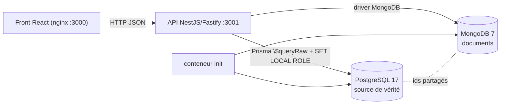

# Billetto — Document de présentation

Projet final « Bases de données relationnelles et non relationnelles » — M1 Développement, EFREI.
Dépôt : <https://github.com/mael-cv/Billetto> · Vidéo : voir [`docs/video/`](video/README.md) · README : [`../README.md`](../README.md).

Sommaire : [1. Le projet](#1-le-projet) · [2. Architecture](#2-architecture) · [3. Modèle relationnel](#3-modèle-relationnel-mcd-mld-mpd) · [4. Modèle non relationnel](#4-modèle-non-relationnel-mongodb) · [5. Justification des choix](#5-justification-des-choix-techniques) · [6. Exemples de requêtes](#6-exemples-de-requêtes) · [7. Index et performance](#7-index-et-performance) · [8. Sauvegarde](#8-stratégie-de-sauvegarde) · [9. Limites](#9-limites-et-pistes-damélioration) · [Annexe : grille](#annexe--correspondance-avec-la-grille-dévaluation)

---

## 1. Le projet

**Contexte.** Billetto est une billetterie événementielle : des organisateurs publient des événements (concerts, festivals, matchs, conférences, spectacles) avec plusieurs tarifs et quotas ; des visiteurs achètent des billets, les reçoivent avec un QR code, peuvent les faire rembourser, s'inscrire en liste d'attente ou poser une réservation temporaire ; le jour J, l'organisateur scanne les billets (y compris hors ligne) et suit ses ventes en direct.

**Utilisateurs et rôles** (colonne `utilisateurs.role_app`, reprise par les rôles PostgreSQL) :

| Rôle | Ce qu'il fait | Compte de démonstration |
|---|---|---|
| Visiteur (`visitor`) | recherche, fiche événement, achat, billets, remboursement, liste d'attente, **avis** | `demo-visiteur@billetto.test` |
| Organisateur (`organizer`) | ses événements, tarifs, participants, check-in, tableau de bord, **page éditoriale**, **réponses aux avis**, **courbe d'activité** | `demo-organisateur@billetto.test` |
| Administrateur (`admin`) | tout voir, changer les rôles, rembourser, purger le journal | `demo-admin@billetto.test` |

**Fonctionnalités principales.** Catalogue avec filtres (ville, type et sous-types, prix, dates), achat atomique sans survente (verrou pessimiste, `acheter_billet`), réservations avec TTL, liste d'attente FIFO, webhooks de paiement idempotents, check-in signé HMAC avec rejeu offline, e-mails (outbox), tableau de bord live ; et côté documentaire : pages d'événement enrichies (programme, médias, FAQ), avis des acheteurs avec réponse de l'organisateur, journal d'activité alimentant un classement « Tendances ».

---

## 2. Architecture




| Composant | Rôle | Dossier |
|---|---|---|
| `web` | React 19 / Vite / Tailwind, servi par nginx | `apps/web` |
| `api` | NestJS + Fastify ; un module par domaine ; Prisma en `$queryRaw` (le SQL versionné reste la source de vérité) ; driver MongoDB officiel | `apps/api` |
| `postgres` | PostgreSQL 17, schéma 3NF, vues, fonctions, triggers, RLS, rôles | `database/migrations`, `database/seed` |
| `mongodb` | MongoDB 7, 5 collections avec validateurs `$jsonSchema` et index | `database/nosql` |
| `init` | à chaque `docker compose up` : migrations SQL → seed SQL si vide → schéma Mongo → seed Mongo si vide | `database/scripts/init-auto.mjs` |
| `mailpit`, `pgadmin` | SMTP de développement, administration (compte `billetto_bi` lecture seule) | `infra/` |

**Flux d'une lecture croisée** (`GET /events/tendances`) : pipeline d'agrégation MongoDB sur `activites` (score par événement) → liste d'identifiants → `SELECT … WHERE id IN (…)` dans PostgreSQL sous le rôle visiteur (la RLS ne renvoie que les événements publiés) → fusion dans l'ordre du score.

**Flux d'une écriture croisée** (`POST /events/:id/avis`) : requête SQL sous le rôle de l'acheteur (« a-t-il un billet payé pour cet événement ? », la RLS ne lui montre que ses billets) → `insertOne` dans `avis` ; l'index unique `{evenementId, utilisateurId}` refuse un second avis (409).

---

## 3. Modèle relationnel (MCD, MLD, MPD)

### 3.1 MCD (modèle conceptuel)


Source Mermaid : [`schemas/mcd.mmd`](schemas/mcd.mmd). Entités : ORGANISATEUR, LIEU, TYPE_EVENEMENT (hiérarchie réflexive), EVENEMENT, ATTRIBUT (clé/valeur libre d'un événement), TARIF, UTILISATEUR, COMMANDE, BILLET, PAIEMENT, RESERVATION, INSCRIPTION_ATTENTE, SCAN. Cardinalités notables : une COMMANDE contient **1,n** BILLETS d'un seul TARIF ; un BILLET appartient à un UTILISATEUR (porteur) et à une COMMANDE (acheteur, souvent le même) ; un TYPE_EVENEMENT a **0,1** parent ; l'amitié est une association réflexive n,n entre UTILISATEURS.

### 3.2 MLD (modèle logique)


Source : [`schemas/mld.mmd`](schemas/mld.mmd). Règles de passage appliquées :

- chaque entité → une table avec une clé technique `bigint GENERATED ALWAYS AS IDENTITY` (décision D4) ; les clés naturelles deviennent des `UNIQUE` (`utilisateurs.email`, `evenements.slug`, `billets.code`, `paiements.reference`, `(tarifs.evenement_id, nom)`, `(evenement_attributs.evenement_id, cle)`) ;
- associations 1,n → clé étrangère côté n (`evenements.organisateur_id`, `billets.commande_id`…), toutes `NOT NULL` sauf `type_evenements.parent_id` (racine) et `utilisateurs.organisateur_id` (seulement pour un organisateur : `CHECK ((role_app = 'organizer') = (organisateur_id IS NOT NULL))`) ;
- association n,n `amitié` → table `amities (utilisateur_id, ami_id, statut)` avec `UNIQUE` et `CHECK (utilisateur_id <> ami_id)` ;
- énumérations en `text` + `CHECK` (décision D5) plutôt qu'en `ENUM` pour pouvoir ajouter une valeur par simple migration (`commandes.statut` a reçu `en_attente_virement` en 009) ;
- montants en `numeric(10,2)` / `numeric(12,2)`, jamais en flottant (D7) ; instants en `timestamptz`, le fuseau d'affichage est une donnée de l'événement (`fuseau_horaire`, validé par trigger) ;
- `journal_tarifs` n'a volontairement **pas** de clé étrangère : l'audit doit survivre à la suppression d'un tarif.

Le schéma est en 3NF : chaque attribut non clé dépend de la clé, de toute la clé et rien que de la clé ; les données dérivées (places restantes, chiffre d'affaires, taux de remplissage) ne sont pas stockées mais calculées par fonctions et vues (`places_restantes()`, `v_ventes_par_evenement`, `v_remplissage`), sauf la vue matérialisée `mv_ventes_quotidiennes` rafraîchie explicitement. La seule exception assumée est `evenement_attributs` (EAV) pour des caractéristiques variables par événement, validées par le trigger `trg_evenement_attributs_validate`.

### 3.3 MPD (modèle physique) : le script de création commenté

Le MPD est le SQL versionné de [`database/migrations/`](../database/migrations/), appliqué dans l'ordre par `database/scripts/migrate.mjs` (une transaction par fichier, table `schema_migrations`). Chaque fichier est commenté en tête et par bloc :

| Fichier | Contenu | Points notables |
|---|---|---|
| [`001_schema.sql`](../database/migrations/001_schema.sql) | 12 tables, PK, FK, `NOT NULL`, `UNIQUE`, `CHECK` | volontairement **sans index** sur les FK pour mesurer l'avant/après (§7) ; `CHECK` de format (e-mail, code postal, slug), de cohérence (`fin > debut`, `date_fin_vente > date_debut_vente`), de signe (`prix >= 0`, `quota > 0`) |
| [`002_views.sql`](../database/migrations/002_views.sql) | 3 vues + 1 vue matérialisée | chaîne de dépendances documentée, `security_invoker` pour que la RLS s'applique au travers des vues |
| [`003_indexes.sql`](../database/migrations/003_indexes.sql) | 5 index B-tree | chacun justifié par un plan `EXPLAIN (ANALYZE, BUFFERS)` (§7) |
| [`004_functions_triggers.sql`](../database/migrations/004_functions_triggers.sql) | `acheter_billet` (verrou `FOR UPDATE`, codes d'erreur `BTxxx`), `rembourser_commande` (procédure), triggers d'audit et de cohérence | la règle « jamais de survente » vit dans la base, pas dans l'API |
| [`005_security.sql`](../database/migrations/005_security.sql) | rôles `billetto_visiteur` / `_organisateur` / `_admin`, compte applicatif `billetto_app` (jamais superutilisateur), `GRANT`/`REVOKE` colonne par colonne, RLS | l'API fait `SET LOCAL ROLE` + `set_config('app.user_id')` par transaction |
| 006 → 016 | objets des phases suivantes : réservations, liste d'attente, check-in (`scanner_billet`, HMAC), dashboard, e-mails, webhooks idempotents, sessions, compte BI | voir [`doc/database.md`](../doc/database.md) |

Extrait commenté (`001_schema.sql`, table `billets`) :

```sql
-- Table lourde (~1,8 M lignes en seed FULL).
-- Une vente = un billet dont la commande est au statut 'paid'.
CREATE TABLE billets (
    id              bigint GENERATED ALWAYS AS IDENTITY,
    tarif_id        bigint        NOT NULL,            -- quel tarif (donc quel événement)
    commande_id     bigint        NOT NULL,            -- l'achat qui l'a produit
    utilisateur_id  bigint        NOT NULL,            -- le porteur (RLS : ne voit que les siens)
    code            uuid          NOT NULL DEFAULT gen_random_uuid(),   -- imprimé dans le QR
    prix_paye       numeric(10,2) NOT NULL,            -- figé à l'achat (le tarif peut changer)
    created_at      timestamptz   NOT NULL DEFAULT now(),
    CONSTRAINT pk_billets PRIMARY KEY (id),
    CONSTRAINT uq_billets_code UNIQUE (code),
    CONSTRAINT fk_billets_tarif_id    FOREIGN KEY (tarif_id)    REFERENCES tarifs (id)    ON DELETE RESTRICT,
    CONSTRAINT fk_billets_commande_id FOREIGN KEY (commande_id) REFERENCES commandes (id) ON DELETE RESTRICT,
    CONSTRAINT fk_billets_utilisateur_id FOREIGN KEY (utilisateur_id) REFERENCES utilisateurs (id) ON DELETE RESTRICT,
    CONSTRAINT ck_billets_prix_paye_positive CHECK (prix_paye >= 0)
);
```

**Jeu de données** (`database/seed/seed.sql`, déterministe, 100 % set-based) — mode `small` chargé par `docker compose up` : 20 organisateurs, 30 lieux, 100 événements, 300 tarifs, 1 000 utilisateurs, 5 000 commandes, **10 000 billets**, 5 147 paiements, 2 000 amitiés. Mode `full` pour les mesures : 5 001 événements, 100 000 utilisateurs, **1,8 M de billets**.

---

## 4. Modèle non relationnel (MongoDB)

Base `billetto_nosql`, 5 collections. Schéma, validateurs et index : [`database/nosql/schema.mjs`](../database/nosql/schema.mjs) ; peuplement : [`database/nosql/seed-nosql.mjs`](../database/nosql/seed-nosql.mjs) (lit les identifiants dans PostgreSQL, puis génère les documents avec la même graine `SEED` que le seed SQL).

| Collection | Documents (small) | Modélisation | Index |
|---|---:|---|---|
| `event_pages` | 100 (1 par événement) | **embarquée** : programme, médias, sections, FAQ dans un seul document | unique `evenementId`, unique `slug`, `organisateurId`, `tags` (multikey), **texte** `programme.artiste`/`sections.content`/`faq.question` |
| `avis` | 2 119 | **référencée** vers l'événement et l'utilisateur SQL, réponse de l'organisateur **imbriquée**, prénom dénormalisé | unique `{evenementId, utilisateurId}`, `{evenementId, createdAt}`, `utilisateurId`, **partiel** `{evenementId, utile}` où `note ≤ 2` |
| `activites` | 20 060 | **référencée**, charge utile `payload` libre selon le `type` (5 types) | `{evenementId, ts}`, `{type, ts}`, `{utilisateurId, ts}` (sparse), **TTL** sur `ts` (90 jours) |
| `event_templates`, `ticket_templates` | 5 + 5 | embarquée (thème, textes) | unique `templateId` |

### 4.1 Exemple commenté : une page d'événement (`event_pages`)

```js
{
  _id: ObjectId('6ae464c99b49368cf8cea0e1'),
  evenementId: 1,            // = evenements.id (PostgreSQL) — clé de jointure applicative, index unique
  organisateurId: 20,        // = organisateurs.id, pour lister les pages d'un organisateur
  slug: 'evt-1',             // dupliqué depuis SQL : lecture directe par URL sans passer par PostgreSQL
  templateId: 'concert',     // référence vers event_templates (petite collection de référence)
  tags: ['famille'],         // tableau indexé (index multikey) : filtre $in / $all
  programme: [               // EMBARQUÉ : toujours lu et écrit avec la page, borné (≤ 100 créneaux)
    { heure: ISODate('2025-11-30T23:00:00Z'), scene: 'Plateau B',
      titre: 'Ouverture des portes', artiste: 'Les Frères Kaplan', dureeMin: 88 },
    { heure: ISODate('2025-11-30T23:35:00Z'), scene: 'Plateau B',
      titre: 'Set 1', artiste: 'Odile Marchand', dureeMin: 80 }
  ],
  medias:   [ { type: 'image', url: 'https://picsum.photos/seed/evt-1-0/1200/630', legende: 'Affiche officielle' } ],
  sections: [ { title: 'Vestiaire', content: 'Vestiaire payant (2 €) à l’entrée principale…' } ],
  faq:      [ { question: 'Puis-je sortir et revenir ?', answer: 'Non, toute sortie … est définitive.' } ],
  updatedAt: ISODate('2025-08-02T23:00:00Z')
}
```

Pourquoi **embarqué** : la page est lue d'un bloc par la fiche événement et remplacée d'un bloc par l'organisateur (`replaceOne … upsert`) ; aucune sous-partie n'est interrogée seule ni partagée entre événements ; la taille est bornée par le validateur (`maxItems`). En relationnel il aurait fallu quatre tables filles (`programme`, `medias`, `sections`, `faq`) et quatre jointures pour reconstruire un objet qui n'est jamais consulté autrement qu'entier.

### 4.2 Exemple commenté : un avis (`avis`)

```js
{
  evenementId: 1, utilisateurId: 88,        // références SQL ; l'index unique (evenementId, utilisateurId)
                                            // garantit « un avis par acheteur et par événement »
  utilisateur: { prenom: 'Inès' },          // dénormalisé : affiché sans jointure, jamais mis à jour (snapshot)
  note: 4,                                  // validateur : bsonType int, minimum 1, maximum 5 (≈ CHECK)
  titre: 'Belle organisation',
  commentaire: 'Très bon moment, juste un peu de queue au bar.',
  utile: 11,
  createdAt: ISODate('2025-12-02T04:00:00Z'),
  reponseOrganisateur: {                    // IMBRIQUÉ, optionnel : 0 ou 1 réponse, posée par $set
    texte: 'Nous sommes désolés pour cette attente, l’équipe d’accueil sera renforcée.',
    date: ISODate('2025-12-02T14:00:00Z')
  }
}
```

Pourquoi **référencé** : le volume d'avis est proportionnel aux ventes (potentiellement des milliers par événement), on les pagine et on les agrège (moyenne, distribution) — les embarquer dans la page d'événement ferait grossir un document sans borne et interdirait la pagination côté serveur.

### 4.3 Exemple commenté : une activité (`activites`)

```js
{ type: 'scan_checkin',                     // enum validé : vue_evenement | recherche | scan_checkin | connexion | achat
  ts: ISODate('2026-10-30T09:39:13Z'),      // index TTL : purgé automatiquement 90 jours plus tard
  utilisateurId: 1002, evenementId: 42,     // références SQL, nullables (une recherche n'a pas d'événement)
  payload: { resultat: 'ok', appareil: 'scanner-1', horsLigne: true } }   // forme libre selon le type
{ type: 'recherche', ts: …, utilisateurId: 1001, evenementId: null,
  payload: { q: 'Tour', resultats: 5, filtres: { ville: 'Lyon' } } }
```

Le même document type décrit cinq événements de formes différentes : c'est le cas d'école du schéma souple. L'API l'écrit en « fire-and-forget » (`insertOne` non attendu) : une télémétrie ne doit jamais ralentir ni faire échouer un achat.

---

## 5. Justification des choix techniques

### 5.1 Pourquoi PostgreSQL pour le cœur transactionnel

Ventes, quotas, paiements, remboursements, réservations et check-in exigent : des **transactions** multi-tables (une commande + ses billets + son paiement, tout ou rien), des **contraintes** d'intégrité (clés étrangères, `CHECK`, unicité des codes), un **verrouillage** fin pour l'anti-survente (`SELECT … FOR UPDATE` dans `acheter_billet`, testé avec 40 achats simultanés sur un quota de 10 : exactement 10 ventes), des **jointures** et **agrégats** complexes (CA par événement, taux de remplissage, arbre des types en `WITH RECURSIVE`), et un **contrôle d'accès par ligne** (RLS : un organisateur ne voit que ses événements, un acheteur que ses billets). PostgreSQL fournit tout cela nativement ; la logique critique est dans la base (fonctions `SECURITY DEFINER`, triggers), de sorte qu'aucun client, même bogué, ne peut survendre.

### 5.2 Pourquoi MongoDB pour le contenu, les avis et la télémétrie

| Donnée | Caractéristique | Ce que MongoDB apporte | Ce que ça coûterait en SQL |
|---|---|---|---|
| Page éditoriale | agrégat hiérarchique, lu/écrit d'un bloc, structure qui varie par organisateur (un match n'a pas de « set », une conférence pas de « scène ») | document embarqué, validateur souple, `replaceOne` atomique | 4 tables filles, 4 jointures, migrations à chaque nouveau type de bloc |
| Avis + réponse | volume ∝ ventes, réponse optionnelle imbriquée, statistiques fréquentes | pipeline `$group`/`$avg`, `$set` sur champ imbriqué, index partiel sur les avis négatifs | faisable mais sans valeur ajoutée ; choisi en Mongo parce qu'il est lié à la page et lu avec elle |
| Journal d'activité | écritures massives (chaque vue, recherche, scan), schéma libre par type, rétention limitée, agrégations temporelles | `insertOne` hors transaction, **index TTL** (purge automatique), `$dateTrunc`, `$facet` | table append-only de plusieurs millions de lignes à purger par cron, colonne `jsonb` sans contrainte de forme, charge d'écriture sur la base transactionnelle |

Le journal est le cas le plus fort : le trafic de lecture (vues) est des ordres de grandeur au-dessus du trafic de vente, et ne doit pas partager les verrous, le WAL et les sauvegardes de la base des paiements.

**Pourquoi pas `jsonb` dans PostgreSQL ?** C'était l'alternative sérieuse pour la page éditoriale. Elle a été écartée parce que (1) le journal d'activité, lui, n'a rien à faire dans la base transactionnelle (volume, TTL), et une fois MongoDB présent, y mettre aussi le contenu éditorial garde une frontière nette : *PostgreSQL = ce qui engage de l'argent ou des droits ; MongoDB = ce qui décrit, commente ou mesure* ; (2) un `jsonb` sans validateur devient vite un fourre-tout, alors que le `$jsonSchema` de MongoDB joue le rôle de `CHECK` ; (3) la mise à jour partielle d'un champ imbriqué (`$set: { 'reponseOrganisateur': … }`) et les index partiels/TTL sont plus directs.

### 5.3 Où va chaque donnée (règle de répartition)

| Dans PostgreSQL | Dans MongoDB |
|---|---|
| identité et rôles, événements, lieux, tarifs, quotas, commandes, billets, paiements, réservations, liste d'attente, scans de check-in, e-mails à envoyer, webhooks | pages éditoriales, templates visuels, avis et réponses, journal d'activité |
| tout ce qui doit être **exact, contraint et transactionnel** | tout ce qui est **descriptif, volumineux ou éphémère** |

### 5.4 Comment les deux bases sont reliées

- **Identifiants partagés** : les documents portent les clés primaires SQL (`evenementId`, `utilisateurId`, `organisateurId`), jamais l'inverse. Aucune clé étrangère entre bases : la cohérence est **applicative**, dans les use-cases de l'API.
- **Source de vérité** : PostgreSQL. Un événement supprimé en SQL entraîne la suppression de sa page, de ses avis et de ses activités (`DeleteEventUseCase`). Un document Mongo orphelin est au pire ignoré (la lecture croisée part toujours de SQL).
- **Contrôle d'accès** : toujours vérifié côté SQL avant d'écrire en Mongo. Poster un avis exige un billet payé (requête sous le rôle de l'acheteur) ; modifier une page ou répondre à un avis exige que l'événement soit visible dans le périmètre `manage` de l'organisateur (RLS). MongoDB ne connaît pas les rôles : il ne reçoit que des écritures déjà autorisées.
- **Lecture croisée** : `GET /events/:ref/page` (SQL → Mongo), `GET /events/tendances` (Mongo → SQL, qui filtre les non publiés), `GET /events/:ref/avis` (SQL pour l'existence et la visibilité, Mongo pour les documents et les stats).
- **Cohérence éventuelle assumée** : le prénom dénormalisé dans un avis est un instantané ; le journal est en best-effort. Ce sont des données d'affichage, pas de facturation.

---

## 6. Exemples de requêtes

### Q1 — Ventes par événement (CTE + jointure externe) — `database/queries/q1_ventes_par_evenement.sql`

Intention : chiffre d'affaires et billets vendus par événement, **y compris ceux sans vente** (le `LEFT JOIN` depuis `evenements` les conserve avec 0, un `INNER JOIN` les ferait disparaître).

```sql
WITH ventes AS (
    SELECT t.evenement_id, count(*) AS billets_vendus, sum(b.prix_paye) AS ca
    FROM billets b
    JOIN commandes c ON c.id = b.commande_id AND c.statut = 'paid'
    JOIN tarifs t    ON t.id = b.tarif_id
    GROUP BY t.evenement_id)
SELECT e.id, e.nom, e.debut, e.statut, coalesce(v.billets_vendus, 0) AS billets_vendus, coalesce(v.ca, 0) AS ca
FROM evenements e LEFT JOIN ventes v ON v.evenement_id = e.id
ORDER BY ca DESC, e.id LIMIT 50;
```

```
 id |      nom           |         debut          |  statut   | billets_vendus |    ca
----+--------------------+------------------------+-----------+----------------+----------
 32 | Moonlight Tour #32 | 2026-12-29 01:00:00+00 | published |            132 | 14044.80
 43 | Kinetic Live #43   | 2025-12-24 22:00:00+00 | finished  |            144 | 13453.20
 46 | Wild Live #46      | 2026-11-17 23:00:00+00 | published |            138 | 13333.80
```

### Q6 — Utilisateurs sans commande (`NOT EXISTS` contre `LEFT JOIN … HAVING` et sous-requête corrélée) — `q6_utilisateurs_sans_commande.sql`

Intention : comparer trois écritures du même besoin. La version `NOT EXISTS` est planifiée en *Hash Anti Join* et s'arrête à la première commande trouvée ; la sous-requête `count(*)` corrélée compte toutes les commandes de chaque utilisateur et est **9 400 fois** plus lente sans index (§7, B8).

```sql
SELECT u.id, u.email FROM utilisateurs u
WHERE NOT EXISTS (SELECT 1 FROM commandes c WHERE c.utilisateur_id = u.id) ORDER BY u.id;
--  id  |        email          → 1 | user1@billetto.test, 272 | user272@…, 292 | …  (105 lignes)
```

### Q8 — Arbre des types d'événements (`WITH RECURSIVE`) — `q8_arbre_types.sql`

Intention : afficher la hiérarchie Musique > Concert > Rock avec niveau et chemin ; la même CTE sert au filtre « type et sous-types » du catalogue (`GET /events?typeId=`).

```
 id |     nom     | niveau |           chemin            |   affichage
----+-------------+--------+-----------------------------+---------------
  1 | Musique     |      1 | Musique                     | Musique
  2 | Concert     |      2 | Musique > Concert           |   Concert
  3 | Rock        |      3 | Musique > Concert > Rock    |     Rock
  6 | Festival    |      2 | Musique > Festival          |   Festival
```

Autres requêtes SQL du dépôt : `q3` taux de remplissage (`FILTER`), `q4` CA par lieu (`HAVING`), `q5` ventes quotidiennes (vue matérialisée), `q7` CA par ville et type (`GROUPING SETS`), fonctions `acheter_billet`, `scanner_billet`, `traiter_paiement_webhook` (`database/migrations/004`, `011`, `014`).

### N1 — Événements tendance (pipeline d'agrégation) — `database/nosql/queries/n1_tendances.mongodb.js`

Intention : score pondéré des activités des 7 derniers jours (vue 1, scan 2, achat 5), visiteurs distincts ; c'est la requête de `GET /events/tendances`, croisée ensuite avec PostgreSQL.

```js
db.activites.aggregate([
  { $match: { ts: { $gte: depuis }, evenementId: { $ne: null } } },
  { $group: { _id: '$evenementId',
      vues:   { $sum: { $cond: [{ $eq: ['$type', 'vue_evenement'] }, 1, 0] } },
      achats: { $sum: { $cond: [{ $eq: ['$type', 'achat'] }, 1, 0] } },
      scans:  { $sum: { $cond: [{ $eq: ['$type', 'scan_checkin'] }, 1, 0] } },
      visiteurs: { $addToSet: '$utilisateurId' } } },
  { $project: { evenementId: '$_id', vues: 1, achats: 1, scans: 1,
      visiteursDistincts: { $size: { $setDifference: ['$visiteurs', [null]] } },
      score: { $add: ['$vues', { $multiply: ['$achats', 5] }, { $multiply: ['$scans', 2] }] } } },
  { $sort: { score: -1 } }, { $limit: 8 }])
// → { evenementId: 28, vues: 624, achats: 116, scans: 51, visiteursDistincts: 416, score: 1306 }, { evenementId: 7, … score: 1251 }, …
```

### N2 — Note moyenne et distribution par événement (`$group`, `$avg`, `$match` ≈ `HAVING`) — `n2_notes_par_evenement.mongodb.js`

```js
db.avis.aggregate([
  { $group: { _id: '$evenementId', nbAvis: { $sum: 1 }, moyenne: { $avg: '$note' }, distribution: { $push: '$note' },
              avecReponse: { $sum: { $cond: [{ $ifNull: ['$reponseOrganisateur', false] }, 1, 0] } } } },
  { $match: { nbAvis: { $gte: 5 } } },            // équivalent HAVING
  { $project: { evenementId: '$_id', nbAvis: 1, moyenne: { $round: ['$moyenne', 2] },
                tauxReponse: { $round: [{ $divide: ['$avecReponse', '$nbAvis'] }, 2] },
                distribution: { $arrayToObject: { $map: { input: [1,2,3,4,5], as: 'n',
                  in: { k: { $toString: '$$n' }, v: { $size: { $filter: { input: '$distribution', as: 'x', cond: { $eq: ['$$x', '$$n'] } } } } } } } } } },
  { $sort: { moyenne: -1, nbAvis: -1 } }, { $limit: 10 }])
// → { evenementId: 34, nbAvis: 28, moyenne: 4.32, tauxReponse: 0.21, distribution: { '1': 0, '2': 1, '3': 4, '4': 8, '5': 15 } }
```

### N3 — Filtre sur champ imbriqué et mise à jour imbriquée — `n3_avis_sans_reponse.mongodb.js`

```js
db.avis.find({ note: { $lte: 2 }, 'reponseOrganisateur.date': { $exists: false } },
             { evenementId: 1, 'utilisateur.prenom': 1, note: 1, commentaire: 1, utile: 1 })
       .sort({ utile: -1, createdAt: -1 }).limit(10);                 // file de modération, index partiel ix_negatifs
db.avis.updateOne({ _id, reponseOrganisateur: { $exists: false } },
                  { $set: { reponseOrganisateur: { texte: 'Merci, nous vous recontactons.', date: new Date() } } });
```

N4 (recherche `$text` + `$elemMatch` + `$unwind` sur les tags) et N5 (série temporelle `$dateTrunc`, `$facet`) sont dans le même dossier ; `pnpm db:queries:nosql` les exécute toutes dans `mongosh`.

---

## 7. Index et performance

### 7.1 PostgreSQL : `EXPLAIN (ANALYZE, BUFFERS)` avant / après (seed FULL, 1,8 M billets)

Méthode (détail dans [`doc/performance.md`](../doc/performance.md)) : le schéma 001 ne crée aucun index sur les clés étrangères ; `pnpm db:benchmark before` enregistre le plan médian de 3 exécutions de 10 requêtes ; la migration 003 crée 5 index justifiés par ces plans ; `pnpm db:benchmark after` puis `compare`. Plans complets dans `database/benchmarks/before/` et `after/`.

| Requête | Avant | Après | Gain | Plan avant → après |
|---|---:|---:|---:|---|
| B1 billets d'une commande (`idx_billets_commande_id`) | 158,8 ms | 0,30 ms | ×526 | Parallel Seq Scan (600 k lignes rejetées / worker) → Index Scan |
| B5 CA d'un événement (`idx_billets_tarif_id`) | 347,6 ms | 6,71 ms | ×52 | Hash Join sur Seq Scan → Nested Loop + Bitmap Index Scan |
| B8 Q6 version corrélée (`idx_commandes_utilisateur_id`) | 10 054,9 ms | 1,07 ms | ×9 406 | 200 × Seq Scan (900 k lignes chacun) → 200 × Index Only Scan |
| B7 Q6 `NOT EXISTS` | ≈ 350 ms | ≈ 500 ms | ≈ 1 | Hash Anti Join inchangé : l'index ne sert à rien quand toute la table est parcourue |
| B9 Q1 global | 2 252 ms | 2 593 ms | ≈ 1 | idem : agrégat sur toute la table, l'index n'aide pas |

Deux enseignements honnêtes : un index n'accélère que les accès **sélectifs** (B7 et B9 lisent tout et ne gagnent rien) ; et un index composite envisagé `(utilisateur_id, created_at)` a été retiré après mesure (même plan, 27 Mo au lieu de 8). Coût total ≈ 75 Mo d'index pour 226 Mo de tables.

### 7.2 MongoDB : `explain("executionStats")` avant / après (seed small)

Mesure reproduite par `pnpm db:test:nosql` (test « pas de COLLSCAN ») ; chiffres ci-dessous obtenus avec `hint({ $natural: 1 })` pour forcer le parcours complet puis avec l'index :

| Requête | Sans index | Avec index |
|---|---|---|
| `db.avis.find({ evenementId: 34 }).sort({ createdAt: -1 })` | COLLSCAN + SORT en mémoire, **2 120 documents examinés** pour 28 renvoyés, 4 ms | IXSCAN `ix_evenement_date`, **28 clés / 28 documents**, tri fourni par l'index, 0 ms |
| `db.activites.find({ ts ≥ J-7, evenementId ≠ null })` | COLLSCAN, 20 112 documents examinés pour 7 294 | IXSCAN `ix_evenement_ts`, 7 395 clés examinées pour 7 294 |

Sur 2 000 documents la différence de temps est négligeable ; ce qui compte est le **nombre de documents examinés**, qui devient linéaire dans la taille de la collection sans index et reste proportionnel au résultat avec. L'index TTL, lui, n'accélère rien : il borne la taille de `activites` (purge automatique à 90 jours), ce qu'un `DELETE … WHERE ts < …` planifié devrait faire en SQL.

---

## 8. Stratégie de sauvegarde

| | PostgreSQL | MongoDB |
|---|---|---|
| Quoi | toute la base `billetto` (schéma + données, format custom `-Fc`, compressé) | toute la base `billetto_nosql` (collections, index, validateurs) en archive gzip |
| Outil | `pg_dump -Fc` / `pg_restore --clean --if-exists --single-transaction` | `mongodump --archive --gzip` / `mongorestore --drop` |
| Fréquence proposée | **quotidienne** (cron 03:00), rétention 7 quotidiennes + 4 hebdomadaires ; en production, archivage WAL continu (`archive_command`) pour un RPO < 5 min | quotidienne, rétention 7 jours ; le journal `activites` est reconstructible et tolère une perte, les avis et pages non |
| Objectifs | RPO 24 h (sans WAL), RTO < 15 min | RPO 24 h, RTO < 10 min |
| Vérification | `manifest.txt` écrit à la sauvegarde (comptages) et comparé après restauration | idem |

Scripts : [`scripts/backup.sh`](../scripts/backup.sh) et [`scripts/restore.sh`](../scripts/restore.sh), qui travaillent **dans les conteneurs** (aucun client à installer) :

```bash
./scripts/backup.sh                       # → backups/<horodatage>/{postgres.dump, mongo.archive, manifest.txt}
docker compose stop api                   # pas d'écriture pendant la restauration
./scripts/restore.sh backups/<horodatage> # pg_restore + mongorestore, puis comparaison des comptages
docker compose start api
```

Procédure testée sur ce dépôt (voir la section Vérification du README). Les volumes Docker (`pg_data`, `mongo_data`) ne sont **pas** une sauvegarde : ils vivent avec l'hôte.

---

## 9. Limites et pistes d'amélioration

- **Cohérence inter-bases** : applicative, sans transaction distribuée. Un crash entre la suppression SQL d'un événement et le nettoyage Mongo laisse des orphelins inoffensifs ; une tâche de réconciliation périodique (`evenementId` absents de SQL) serait la suite logique.
- **Double comptage possible des vues** : l'API journalise chaque `GET /events/:ref` et le navigateur envoie la durée de consultation ; le score des tendances compte les deux. Un champ `source` permet de les distinguer, le pipeline pourrait ne garder que l'un des deux.
- **Pas de cache ni de recherche dédiée** : une troisième base (Redis pour les sessions/compteurs, ou un moteur de recherche) serait justifiée en production ; ici l'index texte MongoDB et la RLS PostgreSQL suffisent au périmètre.
- **Avis** : pas de modération ni de signalement ; `utile` n'est pas encore incrémentable depuis le front.
- **Seed Mongo en mode `full`** plafonné à 200 000 activités pour garder un démarrage rapide.
- **Sauvegarde** : scripts manuels ; en production ils seraient planifiés et les archives chiffrées et externalisées.

---

## Annexe : correspondance avec la grille d'évaluation

| Critère | Où le vérifier |
|---|---|
| Schéma PK/FK/`NOT NULL`/`UNIQUE`/`CHECK` | `database/migrations/001_schema.sql`, §3 |
| CRUD relationnel | `doc/api.md` (événements, tarifs, commandes…), tests e2e |
| Jointures internes/externes | `q1` (LEFT JOIN), vues 002, `findSummariesByIds` |
| Agrégats `GROUP BY`/`HAVING`/`FILTER`, sous-requêtes/`EXISTS`, CTE | `q1`–`q8`, §6 |
| Vue utilisée par l'application | `v_ventes_par_evenement`, `v_remplissage`, `mv_ventes_quotidiennes` dans `apps/api/src/modules/analytics` |
| Index + `EXPLAIN` avant/après | `003_indexes.sql`, `database/benchmarks/`, §7 |
| Logique serveur, rôle applicatif limité | `004_functions_triggers.sql`, `005_security.sql` (`billetto_app` non superutilisateur, `SET LOCAL ROLE`) |
| Modélisation documentaire expliquée | §4 |
| CRUD NoSQL | `PUT/DELETE /events/:id/page`, `POST/PATCH/DELETE avis`, `POST/DELETE activites` |
| Pipeline d'agrégation, filtres imbriqués | N1–N5, `reviews.use-cases.ts`, `activity.use-cases.ts` |
| Index / TTL / contrainte NoSQL | `database/nosql/schema.mjs` (validateurs, unique, partiel, texte, TTL) |
| Volume réaliste | 10 000 billets SQL ; 20 060 activités + 2 119 avis + 100 pages Mongo |
| Endpoints croisés, gestion d'erreurs | `/events/tendances`, `/events/:ref/page`, `/events/:id/avis` ; 404/403/409/422 documentés |
| `docker compose` en une commande, scripts de création et de peuplement | `docker-compose.yml`, conteneur `init` |
| README, présentation, schémas, justification, requêtes, sauvegarde | ce document, `README.md`, `docs/schemas/` |
| Bonus : front, tests automatisés, mesures de performance | `apps/web`, `pnpm test` / `test:e2e` / `db:test` / `test:e2e:web`, `doc/performance.md` |
